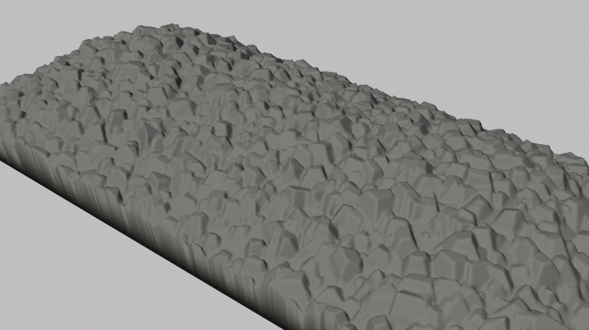
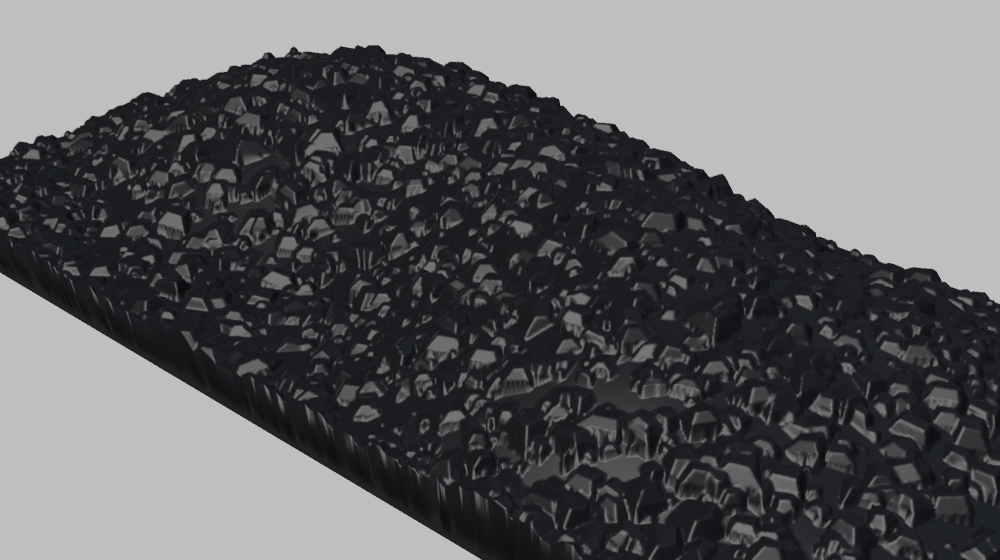
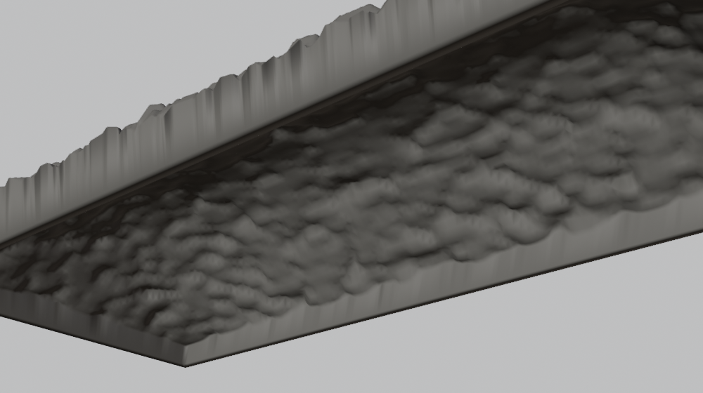

# Ore Load Generator

A Blender 4.5+ add-on that builds 3D-printable **loads for model railroad ore cars**: a hollow shell of hard rock, coal, iron ore, limestone or gravel lumps that drops into the car's opening. You give the size of the car's opening (prototype or model) and the scale; the load's sides start a little smaller at the bottom and flare out to the full opening at the top, so it drops in and wedges at the top of the car sides. Exported as an STL in millimetres.



## Install

In Blender, open Edit > Preferences > Get Extensions, choose "Install from Disk" in the menu at the top right, and pick `dist/ore_load-0.1.0.zip`. The panel is in the 3D Viewport sidebar (N), **Ore Load** tab. No other add-ons are needed.

## Use

The **i** button in the Ore Load panel's header turns the informational lines (summary, sizes, hints) on and off. Errors and warnings are always shown.

1. **Car Opening.** Pick the **Scale** (Z through Fn3, or Custom; narrow gauge uses its scale's ratio, so HOn3 is HO and On30 is O). Enter the inside **Length** and **Width** of the car's opening in prototype inches or millimetres (**Prototype**), or tick **Model** and enter the model car's opening as measured, in millimetres. **Opening Outline** adds a wire rectangle of the opening at the top of the car sides (not exported) to check the fit.
2. **Ore.** Choose the **Ore**: Hard Rock, Coal, Iron Ore, Limestone or Gravel. It fills in the **Smallest Lump** and **Largest Lump** sizes (prototype, in your units) and the lump shape; edit any of them, or click the reset arrow to get the ore's defaults back. **Lump Density** is how many lumps: 1 covers the load, less leaves gaps, more piles them up. **Lump Shape** (closed by default) has the number of faces on a lump (fewer = more angular), its **Lump Height** (coal lies flatter), **Flat Top**, **Roundness** (0 = broken rock, 1 = river gravel) and **Face Variation**.
3. **Loading and Shape.** **Machine** loading packs the lumps evenly in two layers for a uniform load; **Hand** loading scatters them at random, with more small ones, and adds random **Mounds and Hollows** (12 in by default). The **Shape** goes from **Level** to heaped: a **Ridge** along the car (chute loaded), one **Mound**, or a row of **Peaks** (one per loading spout or bay). **Hump Height** is how far the top of the heap rises above the load's edge. **Edge Height** is where the load meets the car sides, above the top of the sides (0 = level with them, negative = below).
4. **Shell and Fit.** The load is hollow and open underneath, **Thickness** thick (1 mm). Its sides reach **Skirt Depth** (3 mm) below the load's edge, starting **Taper** (0.5 mm each side) smaller at the bottom and flaring out to the opening at the top. **Fit Allowance** takes that much off each side of the opening (negative makes it bigger for a tight fit). **Printer** (Resin or FDM) sets the automatic grid and the printability warnings.
5. **Generate Ore Load** and check the summary: the load's top and bottom sizes, how far it rises above the rim, the lump count and triangle count. After generating it also shows the resin volume.
6. **Export STL** writes each selected load to its own file.

Each Generate adds a new load at the 3D cursor with a new random seed. **Lock Seed** in Build Options repeats one you liked. The load's origin is the middle of the opening at the top of the car sides, so it can be snapped onto a car model. Whole setups can be saved as load presets from the menu at the top of the panel; they are JSON files in the extension's user folder and can be copied to another computer.



## How the load is made

- **Base surface.** The overall shape (level, ridge, mound or peaks), with hand loading's random mounds and hollows. Hollows never go below the edge height.
- **Lumps.** Each lump is a small rock: a few sloping faces around a centre, cut flat on top, trimmed by an ellipsoid for roundness, turned and tilted at random and part-buried in the surface. The top surface is the highest of the surface and every lump.
- **Shell.** The top surface is a fine height grid (about a sixth of the smallest lump; **Max Grid Cells** keeps it under 400,000 cells). The inside is every point at least the thickness away from the top, and the inside walls are the thickness in from the sides, so the shell is never thinner than the thickness. The mesh is closed (watertight) and ready to slice; the open underside also lets resin drain.



## Build options

- **Seed / Lock Seed / New Seed**: the random arrangement of lumps.
- **Auto Grid / Grid**: the surface grid spacing. Smaller shows small lumps better but makes bigger files (an HO load is typically 250,000 to 850,000 triangles, a 12 to 40 MB STL).
- **Max Grid Cells**, **Max Lumps**: limits that keep big or fine loads quick to build.

## Files

| File | What it does |
| --- | --- |
| `scales.py` | Scales and unit conversion. Plain Python |
| `ores.py` | Ore types: lump sizes, shape and colour. Plain Python |
| `load.py` | The base surface, lumps, inside surface and the whole load. Plain Python |
| `shell.py` | The hollow, tapered shell mesh from the top and inside surfaces. Plain Python |
| `build.py` | Makes the Blender object, material and outline, and exports the STL |
| `properties.py`, `operators.py`, `ui.py` | Settings, buttons and the sidebar panel |
| `preset_store.py` | Saved load presets (JSON) |

Run the tests without Blender from this folder (needs numpy):

```
python -m unittest discover -s tests -t .
```

Make the install zip with `python build.py`.
